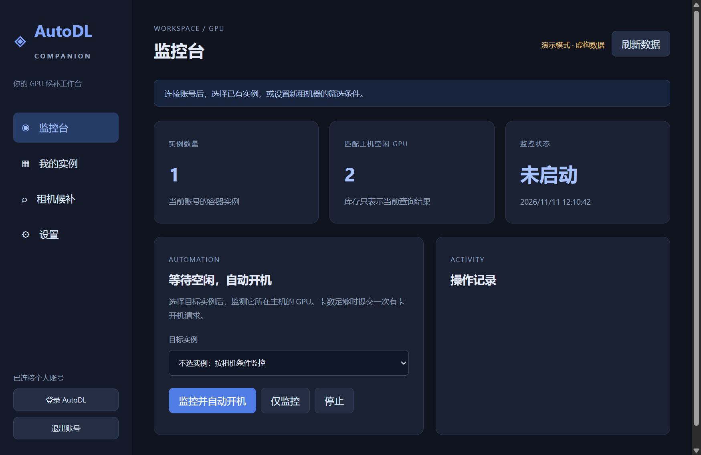

# AutoDL Companion



GitHub 仓库：<https://github.com/lxuetl/autoautodl>。在 Actions 的 **Build Windows** 工作流中下载 `windows-portable` 构建产物，解压后运行 EXE。工作流会在推送到 main 后运行，也可手动触发。构建产物保留 7 天；源代码不包含账号凭据、依赖目录和本地构建缓存。

可分发的 Windows 桌面客户端。每个人在自己的 Windows 账号下登录 AutoDL，应用用系统加密保存自己的 Token；没有集中存储凭据的服务器。不代表支持同一应用同时登录多个账号，也没有组织、团队权限或共享实例管理。

支持实例列表、按目标物理主机检查 GPU 库存、自动有卡开机、租机 GPU/地区/卡数筛选、日志、托盘驻留、演示模式。关闭窗口后继续驻留，托盘“退出”才结束进程。自动开机提交前写入待核实标记，超时或重启后不会重复提交；需在官方页面核实结果后手动解除锁定。

新租机器当前支持库存查询和打开官方市场，镜像、价格与创建由用户在官方页面完成。尚未实现新实例自动创建、账单、自动更新和多人协作后台。

## 使用与构建

需要 Node.js 22 或更新版本：

```powershell
npm ci
npm start
# 用虚构数据预览，不访问 AutoDL
npm run demo
# 生成 Windows 便携 EXE
npm run dist
```

发行文件位于 `release/AutoDL-Companion-0.1.0-Windows.exe`，可复制给其他 Windows 用户。每位用户自行登录。手动刷新后可在“我的实例”选择监控目标；“监控并自动开机”会产生计费操作。选择空目标时，仅监控使用设置里的 GPU、地区标识和卡数。

默认每 45 秒查询，失败后逐步延长间隔。系统休眠、网络断开或退出应用时无法持续抢卡。登录使用内嵌官方页面，只允许 AutoDL 域名；微信登录弹窗暂未支持，可以用官方页面中账号/短信登录。未签名的 Windows 发行文件可能触发 SmartScreen。凭据位于 Electron userData 目录的 profile.json，使用 Windows DPAPI 加密。界面不会接收完整实例响应中的密码等字段。

## 实现与验证边界

独立编写，参考 CrazyAutoDL 的功能与接口调用方式，没有复制其源码和视觉资产。参考仓库未声明开源许可证。网页端接口 `/api/v1/instance`、`/api/v1/user/machine/list`、`/api/v1/instance/power_on` 不是 AutoDL 官方公开开发者 API，可能随网页变化；未用真实账号执行开机测试，不能保证平台允许这类自动化或不会限制账号。

核心测试覆盖主机与卡数匹配、实例状态限制、未知库存拒绝和输入校验。演示模式提供虚构实例与库存用于检查界面。对外发布前需用专门测试账号验证登录、库存、开机结果与账号退出，并对 EXE 做代码签名。

参考：https://github.com/A2ureeE/CrazyAutoDL
