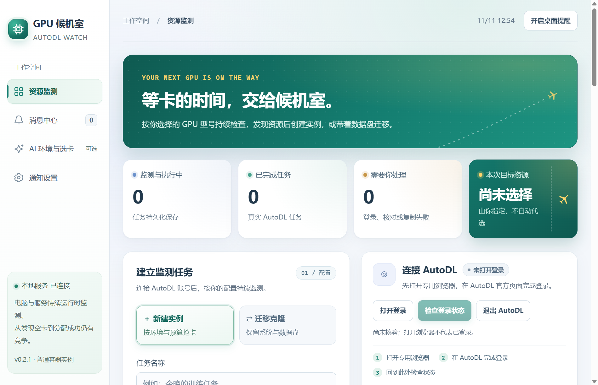

# AutoDL Companion 0.6.5-test.1（预发布）

本版整合共享登录、单台候补、动态监控台和消息中心，并修复便携版重复启动造成的依赖丢失。功能差距及验收条件见 [改进清单](docs/PRODUCT_GAPS.md)。

Windows 桌面版 AutoDL 候补助手。支持已有实例自动开机，以及新建实例、同地区克隆工作台。每个人在自己的电脑上登录、保存任务，不集中保管账号。



## 下载

在 [Releases](https://github.com/lxuetl/autoautodl/releases) 下载 Windows 便携 EXE，直接运行即可，并可用同页的 SHA256SUMS.txt 校验。当前版本标为预发布测试版。便携程序未签名，Windows 可能显示来源提示。

开发构建也可从 [Build Windows](https://github.com/lxuetl/autoautodl/actions/workflows/windows.yml) 下载 windows-portable，产物保留 7 天。维护者推送 v 开头的版本标签时会自动测试、构建并发布到 Releases。

## 新建与克隆

1. 监控台选择已有实例，使用“仅开机”“仅克隆”或“开机或克隆”模式，只抢一台。全新环境从左侧“新建实例”配置。
2. 点击“打开登录”，在专用浏览器自行登录 AutoDL，返回工作台点击“检查登录状态”。验证码需自行完成。
3. 同步官方 GPU 型号与镜像，选择 GPU、卡数、地区和框架 / 版本 / Python 与系统 / CUDA 四级镜像。
4. 先选择“只通知”，或明确勾选费用授权后启用自动创建。提交前重新核对库存与费用，提交后对账；结果不明时停在待核实，避免重复创建。
5. 克隆任务选择同地区已关机的源实例，可复制数据盘并更换 GPU。源实例受只读保护，克隆后仍需检查目标实例中的数据是否完整。

工作台提供任务暂停与恢复、超时、重复任务检测、主机冷却、桌面提醒，以及可选的微信 / Webhook 通知和 AI 环境选卡。外部通知和 AI 需用户自行填写并启用服务凭据，不配置也可使用候补功能。

主窗口和租机页共用本应用专用浏览器的 AutoDL 会话。从任一入口登录一次，开机、新建与克隆共同使用；从任一入口退出都会停止开机监控并暂停租机任务。人工登录完成后自动核验，也可点“检查登录状态”。关闭专用浏览器会暂停任务，需要重新打开并验证后再继续。

切换主窗口页面后，租机表单与后台任务继续保留。退出桌面应用会等待任务引擎与专用浏览器安全关闭。电脑休眠或断网时无法持续候补。

## 已有实例自动开机

在主窗口点击“登录 AutoDL”，刷新列表，选择目标实例并开启“监控并自动开机”。默认每 5 秒检查目标主机空闲 GPU，卡数满足时提交一次有卡开机；结果不明时需核实后再解除锁定。


## 多人使用与存储

每位用户在自己的 Windows 账号下运行客户端。现阶段没有共享服务器、组织权限或同一客户端多账号协作。

- profile.json 仅保存设置与待核实开机记录；旧版独立 Token 在升级加载设置时移除。开机请求直接使用专用浏览器当前会话，不再另存登录凭据。
- 工作台任务、日志、浏览器会话在 userData 下 rent-workspace/。浏览器会话由浏览器保存，不要将整个目录视为加密备份，不要分享该目录。
- 本地服务只绑定随机 127.0.0.1 端口，校验本地请求和访问令牌。不要将该端口代理到公网。
- 外部服务 Key 与通知凭据可选择记住，以 Windows DPAPI 加密保存。

## 开发与构建

需要 Node.js 22+。专用浏览器优先使用 Playwright Chromium，缺失时尝试本机 Edge；没有 Edge 时可运行 npx playwright install chromium。

```powershell
npm ci
npm test
npm start
# 虚构实例演示，不访问 AutoDL
npm run demo
# 输出 Windows 便携 EXE 到 release/
npm run dist
```

## 验证与引用

当前 404 项测试通过，涵盖已有实例判断、工作台回环绑定和访问令牌、新建与克隆、费用限制、提交与对账、重启恢复、凭据处理等。另检查桌面与打包程序的无账号启动。此集成版尚未使用真实账号验证新建、克隆或计费开机，上游实测记录不能当作本版本的实测。

工作台集成 [cc2025cheng/Stop-Manually-Refreshing-AutoDL-GPU](https://github.com/cc2025cheng/Stop-Manually-Refreshing-AutoDL-GPU) 的 MIT 源码、界面与测试，保留许可证，详见 [第三方说明](THIRD_PARTY_NOTICES.md)。本项目增加 Electron 窗口、随机回环服务与退出处理。

已有实例开机模块参考 [CrazyAutoDL](https://github.com/A2ureeE/CrazyAutoDL) 的功能与接口方式，未复制源码。该模块使用非官方公开的网页端接口；新建与克隆工作台通过专用浏览器操作页面。两者可能因 AutoDL 改版失效，也不能保证平台允许自动化或账号不会被限制。

账号状态只有在实例接口验证成功后才显示已验证；保存过凭据不代表登录有效。启动时自动核验，断网显示暂无法验证，鉴权失败显示登录失效并停止开机监控。

## 共享登录测试版升级

首次升级可能需要在专用浏览器登录一次。原租机浏览器已有有效会话时可复用。检测到凭据变化会暂停旧任务；旧会话绑定的租机任务不能在新会话继续执行，应先核实旧提交，再重新建立任务。采用会话绑定，平台刷新凭据也可能要求重建任务，不会自动猜测为同一账号。

余额保护复用主程序的共享账号与余额缓存，无需另外填写余额 Token。微信通知仍需单独配置 AutoDL 开发者 Token。

## 0.5.4-test.1 本地新增

- 已有实例检查间隔 1–3600 秒，新配置默认 5 秒；旧配置保留原值，可在设置修改。一次检查完成后才排下一次，不并发堆积。收到 429 按 Retry-After 等待，连续失败指数退避；界面显示下次检查倒计时。
- 我的实例支持手动有卡开机和关机、复制 SSH、打开 Jupyter、前往官方控制台释放。关机前确认，提交前重读状态，结果不明保留锁定。
- 展示目标主机 GPU 空闲/总量、内存及系统盘/数据盘剩余量、最早释放时间；字段缺失显示未知。
- 现金、冻结、代金券显示，现金低余额阈值提醒；低余额持续期间只提醒一次，回升后可再次提醒。余额在监控期间最多每分钟自动查询一次。
- 同步近35天账单，14/30/35天切换，净消费柱状图、GPU消费构成、近100条流水、近7天日均及现金续航估算。退款抵扣、充值不计消费；分页上限或未知数据有提示。账单页面自动查询有2分钟缓存，手动同步可刷新。
- 托盘刷新、启动/停止监控、检查更新；设置中可发送测试通知。
- 当前是便携本地测试版：更新入口只查询本仓库已发布版本并允许打开发布页，不自动下载、安装或降级。

本轮参照胡闹 AutoDL 功能自行实现，未复制其未声明许可的源码。未操作真实账号开关机或进行实际计费测试；先测试，再由用户决定是否发布。

本轮继续补齐：今日/近7天/本月净消费，图表支持点击或键盘选择日期查看流水；托盘支持目标选择、仅监控与经确认的自动开机，使用与主窗口相同的状态校验。

界面改版：深色导航、浅色数据区域、GPU 空闲数量示意、资源余量环形图、实例状态标签与用量条、带金额刻度与正负共同尺度的消费图、构成排行。未知资源保留未知；GPU示意仅表示数量，不是物理卡槽位置。使用演示数据检查监控台、实例、账单、租机及900×650窗口和无数据状态。

## 登录与自动同步修复

登录成功后隐藏登录/检查登录入口，保留退出账号。自动完成首次实例与库存同步；未启用抢卡时每15秒自动刷新，失败按退避延长等待。后台自动刷新不授权或执行开机。

后台核验复用已有登录控制台且不置前；登录成功后专用浏览器自动最小化，浏览器进程继续供租机引擎使用。遇到登录失效或验证码会显示需要处理的状态，由用户主动打开登录页；不会每轮弹窗。关闭专用浏览器仍会暂停任务。

实例、库存、余额与账单使用专用浏览器当前会话的 Token，通过接口请求；页面操作复用同一个浏览器。业务错误标出接口和错误码，普通服务错误不会清除已验证登录状态。平台“服务异常”仍可能真实发生，本版本未以真实账号复现该错误，不能保证平台错误被消除。

## 库存 DatabaseError 兼容处理

库存筛选返回 DatabaseError 时，仅尝试一次不含可选型号/地区/计费筛选的查询，再本地严格匹配实例主机（未选实例时按型号和地区精确过滤）。兼容成功的筛选组合缓存10分钟；两次均失败时至少等待30秒再查。其他鉴权、限流和未知错误不会触发该回退。

库存失败清除旧库存并显示未知，不影响实例状态与余额同步，不据此自动开机。“复制库存诊断”增加 GPU、地区、筛选字段、分页位置和错误码，不包含实例 ID、账号或登录凭据。此版本未用真实账号复现 DatabaseError，平台持续故障仍可能需要等待恢复。

## 会话衔接修复

所有登录核验共享同一个进行中的操作，接口读请求等待核验完成。已经验证过且未改变的凭据，在页面暂时无法识别或网络异常时仍允许只读同步；开关机继续要求页面会话有效。凭据改变、登录过期、人工验证不降级放行。重复点击登录复用同一个操作。

未选目标且未主动监控时，不调用全市场库存接口；选定实例后自动立即查询。诊断新增是否选择实例、是否具备主机 ID 两项布尔信息。收到的上一版诊断显示无可选筛选也会 DatabaseError，无法归因于 GPU/地区筛选，仍需具体目标查询反馈，未声称消除平台数据库错误。

## 0.5.4-test.1：按参考项目恢复接口路径

此节替代此前实验性库存兼容与 Cookie 请求方案：

- 已有实例接口恢复原生 fetch、Authorization 和 JSON 请求，不使用 Playwright APIRequestContext，不注入 Origin/Referer。仅产品 User-Agent 使用本应用名称。
- 以 `/instance` 成功且列表结构有效作为接口账号验证证据；页面暂时识别失败不阻断已验证的接口功能。付费请求先重新读实例验证，凭据变化、人工验证和明确鉴权失败仍会拦截。
- 库存只查选中实例，首批100条，型号/地区/计费条件来自该实例；没有主机 ID 不请求。取消全市场查询和去筛选重试；未找到目标主机显示未知。新租继续使用第二个项目的网页候补引擎。
- 对本机保存的参考仓库 API 进行了两个虚构实例的实际差分调用：endpoint/method/JSON body 相同。仅模拟网络，没有读取账号凭据或进行真实计费。

平台 DatabaseError 尚未用真实账号复现，不能将协议对照通过当作真实问题已解决。
