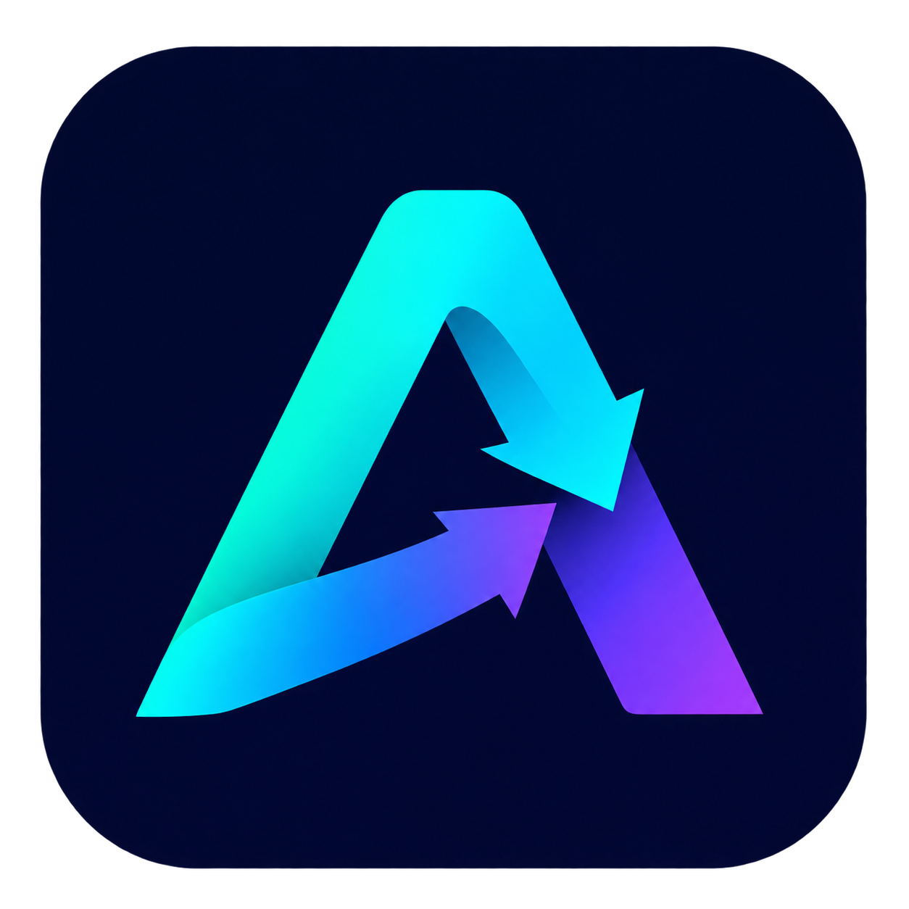

<p align="center"></p>
<h1 align="center">autoautodl</h1>
<p align="center">AutoDL GPU 监控与自动候补桌面助手</p>
<p align="center"><a href="https://github.com/lxuetl/autoautodl/releases/tag/v0.6.6-test.1">下载 Windows 测试版</a> · <a href="#快速开始">快速开始</a> · <a href="#通知设置">通知设置</a></p>

在一个深色工作台中查看 GPU 库存、实例资源、余额与任务进度。支持已有实例开机、克隆和新建实例；首页可以同时候补开机与克隆，目标是**只获取一台**。


## 下载与更新

当前版本：**0.6.6-test.1（预发布测试版）**。

- [下载 Windows 便携版](https://github.com/lxuetl/autoautodl/releases/download/v0.6.6-test.1/autoautodl-0.6.6-test.1-Windows.exe)：下载后直接运行，无需安装 Node.js。
- [全部版本与更新说明](https://github.com/lxuetl/autoautodl/releases)：同页提供 `SHA256SUMS.txt`，可核对下载文件。
- 此版统一名称与图标，更新窗口、侧栏、托盘、通知和 EXE 标识。原有账号会话、设置与任务数据继续使用。

便携程序目前未签名。应用内“检查更新”可查看版本并打开发布页，不会自动安装。更新前请先退出旧程序，再启动新版。

## 主要功能

| 页面 | 可以做什么 |
| --- | --- |
| 监控台 | 查看目标主机空闲 GPU、动态资源仪表、候补进度和操作记录 |
| 我的实例 | 查看实例状态、手动有卡开机与关机、复制 SSH、打开 Jupyter 和官方控制台 |
| 余额与账单 | 查看现金与代金券、净消费趋势、消费构成及近期流水 |
| 新建实例 | 选择 GPU、地区、卡数与镜像，配置只通知或自动创建任务 |
| 消息中心 | 搜索消息，按事件、未读和发送结果筛选，查看各渠道发送详情 |
| 通知设置 | 配置 AutoDL 微信通知或 Webhook，查看辅助引导 |
| AI 环境选卡 | 配置自己的服务凭据后使用可选的环境选卡辅助 |

## 快速开始

1. 启动应用，点击 **登录 AutoDL**，在专用浏览器完成登录及必要的人工验证。
2. 登录核验成功后自动同步实例与余额，登录入口随之隐藏。开机、新建和克隆共用这一账号。
3. 在监控台选择目标实例和候补方式，确认配置后点击 **开始排队（只抢一台）**。只想查看库存时，点击 **仅监控**。
4. 在任务进度与消息中心查看结果。提交成功不等于实例已可用；系统会继续核实状态，克隆还需确认数据盘复制结果。

| 候补方式 | 行为 |
| --- | --- |
| 仅开机 | 等待原实例所在主机释放足够的 GPU，再提交有卡开机 |
| 仅克隆 | 使用所选实例作为源，寻找同地区可用资源创建克隆 |
| 开机或克隆 | 同时等待两类机会，共用单台提交锁；一方提交后，另一方不会重复提交 |

克隆默认带入源实例的 GPU 型号、卡数与地区，继承系统盘环境，无需再次选择镜像。可调整目标 GPU、复制数据盘及最低扩容；复制数据盘时会考虑源实例已有扩容。是否允许克隆以源实例状态与平台检查为准。

### 新建实例

需要全新环境时，进入左侧 **新建实例**，选择官方 GPU 型号、地区、卡数及镜像配置。可以只通知，也可以在确认费用授权后自动创建。提交前读取官方报价并检查配置和余额；余额保护复用共享账号与缓存，不需要另填余额 Token。

切换应用内页面会保留表单与后台任务。新建和克隆的实际页面操作仍会使用专用浏览器，不需要为这些功能另建账号会话。

### 自动刷新与任务核实

- 已有实例监控默认每 5 秒检查，可在设置中改为 1–3600 秒；已有设置保留原值。检查串行进行，限流和连续错误会延长等待时间。
- 未开始候补时，实例信息也会定期自动刷新。选定目标后只查询对应主机库存，不把全市场空闲数当作目标库存。
- 接口缺失或库存查询失败时显示未知，不使用旧库存自动开机；实例与余额可继续独立更新。
- 请求结果不明时，保留提交记录并自动核实，避免重复提交。不要在结果尚未确认时重复手动操作。
- 关闭主窗口会驻留托盘；从托盘退出才会结束应用。电脑休眠、断网或关闭专用浏览器会影响任务运行。

## 通知设置

**任务启动不会发送“抢卡成功”通知。** 已有实例确认开机成功、自动创建或克隆确认完成后才发送完成通知；只通知模式发现匹配资源时发送发现通知。失败、余额不足等事件可能另有提醒，以消息中心的事件类型为准。

| 渠道 | 配置方式 |
| --- | --- |
| 桌面通知 | 使用 Windows 系统通知，可在设置中测试 |
| 微信 | 在 AutoDL 完成微信绑定，并在通知设置中填写 AutoDL 开发者 Token |
| Webhook | 填写接收通知的 HTTP 地址；接收端需支持本应用的 JSON 消息格式 |

通知页面提供配置步骤与排查说明。不配置外部通知也能使用候补功能。Webhook 是把事件发送给另一个服务的地址，并不是个人微信或 QQ 号码；没有内置个人 QQ 直发功能，群机器人可能需要格式转换服务。

消息中心可查看渠道状态、发送次数和失败原因。“已发送”表示接收服务接受了请求，不代表收件人已阅读。

## 账号与本地数据

每个人在自己的电脑和 Windows 账号下使用客户端，登录自己的 AutoDL 账号。当前不是集中管理多人的云端平台，也不提供组织权限或同一客户端多账号协作。

- 为兼容旧版，数据目录仍为 `%APPDATA%\autodl-companion`；内部应用 ID 不随显示名称改变。
- `profile.json` 保存监控设置、目标和待核实提交等状态；工作台任务与浏览器会话保存在其中的 `rent-workspace` 目录。
- 浏览器会话包含登录信息，不要公开或分享整个数据目录。外部服务凭据按相应配置保存，支持 Windows DPAPI 加密。
- 工作台服务只绑定随机本地回环端口，不应代理到公网。
- 退出账号或检测到会话变化会停止、暂停相关任务。旧会话的任务可能需要先核实结果，再重新建立。

## 开发与验证

需要 Node.js 22+。专用浏览器优先使用 Playwright Chromium，缺失时尝试本机 Edge；没有可用浏览器时执行 `npx playwright install chromium`。

```powershell
npm ci
npm test
npm start
# 使用虚构数据预览界面
npm run demo
# 生成 release/autoautodl-<版本>-Windows.exe
npm run dist
```

本版通过 **422 项自动化测试**，并完成打包后的无账号启动、浏览器依赖和界面烟雾检查。演示截图使用虚构数据。这些检查不等同于真实账号下的新建、克隆和计费开机验收。

推送 `v*` 标签会触发 [Windows 构建与发布工作流](https://github.com/lxuetl/autoautodl/actions/workflows/windows.yml)，测试、打包后生成预发布版及 SHA-256 校验文件。

## 已知限制与参考项目

AutoDL 页面和网页端接口变化可能影响功能；平台返回 `DatabaseError` 或服务异常时，应用不能保证消除上游故障。自动化使用需遵守平台规则，本项目不保证库存获取成功或账号不受限制。

首页单台候补采用保守的提交锁，结果未知时不会重复创建。当前已完成的单台任务组没有专门的“重置任务组”入口，后续再次候补的体验仍需完善。

新建与克隆工作台集成了 [Stop-Manually-Refreshing-AutoDL-GPU](https://github.com/cc2025cheng/Stop-Manually-Refreshing-AutoDL-GPU) 的 MIT 源码，并保留许可证。已有实例模块参考 [CrazyAutoDL（胡闹 AutoDL）](https://github.com/A2ureeE/CrazyAutoDL) 的功能与接口方式，未复制其源码。详见 [第三方说明](THIRD_PARTY_NOTICES.md)。
